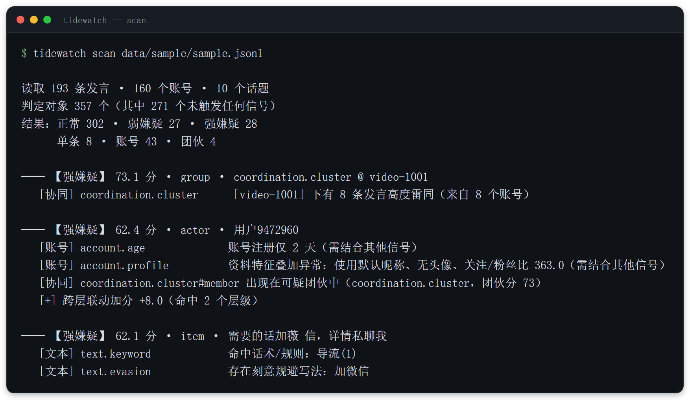
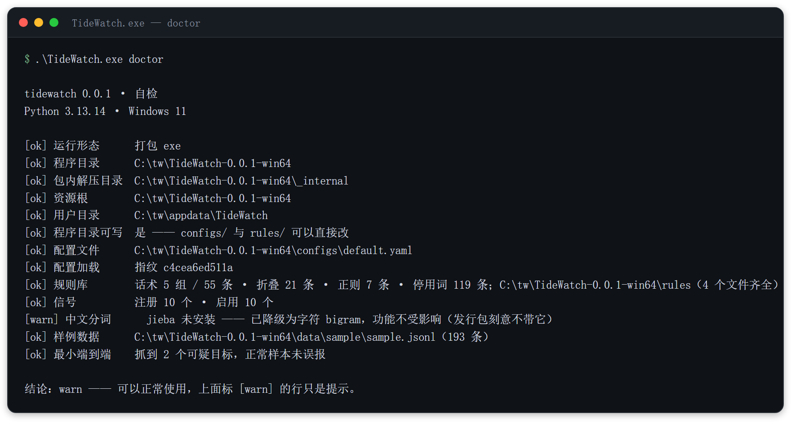
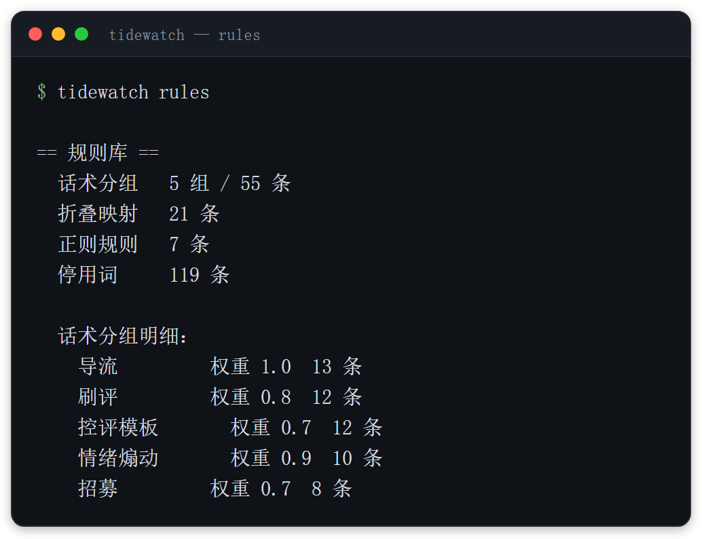

# TideWatch · 观潮

[](https://github.com/whyao56/TideWatch/actions/workflows/ci.yml)
[](https://opensource.org/licenses/MIT)
[](https://www.python.org/)
[](https://pypi.org/project/PyYAML/)

**一个可解释、可插拔、可迭代的网络水军与协同行为识别引擎。**

不用 GPU，不用 API Key，不用数据库。核心依赖只有一个 `PyYAML`。
十个信号分三层工作，每条结论都能追到「哪条规则、哪个证据、贡献了多少分」。

<a id="scan-output"></a>


<sub>**本文所有终端图都是真实执行结果**，不是手画的示意图 —— 由
`scripts/make_readme_shots.py` 从实际运行重新生成，命令变了图就能跟着重跑。
怎么读它：见[快速开始 → 读懂输出](#读懂输出)。</sub>

```
                        ┌───────────────────────────────────────┐
                        │  你的数据（JSONL / 评论 / 弹幕 XML）    │
                        └───────────────────┬───────────────────┘
                                            │  adapters/  字段映射，换源不改引擎
                                            ▼
                    ┌───────────────────────────────────────────────┐
                    │  统一数据模型 Dataset（平台无关）               │
                    └───────────────────┬───────────────────────────┘
                                        │  pipeline
        ┌───────────────────────────────┼───────────────────────────────┐
        ▼                               ▼                               ▼
┌──────────────────┐          ┌──────────────────┐          ┌──────────────────────┐
│  文本层（4 信号） │          │  账号层（3 信号）  │          │    协同层（3 信号）    │
│  最便宜、最易规避 │    →     │  弱信号、不定案   │    →     │  最贵、最难伪造 ←核心  │
├──────────────────┤          ├──────────────────┤          ├──────────────────────┤
│ template 模板化   │          │ age 注册年龄      │          │ burst 时间爆发        │
│ repetition 刷屏   │          │ originality 原创度│          │ cluster 文本聚类      │
│ keyword 话术/正则 │          │ profile 资料异常  │          │ cooccur 共现图谱      │
└──────────────────┘          └──────────────────┘          └──────────────────────┘
                                        │
                                        ▼  scoring  加权 + 跨层联动 + 保底提档
                            ┌───────────────────────────────┐
                            │  可解释报告（文字 / JSON / MD） │
                            │  正常 · 弱嫌疑 · 强嫌疑         │
                            └───────────────────────────────┘
                                        │
                                        └─ 团伙 → 成员传播：指出「具体哪些账号」
```

---

## 为什么这样做

水军检测最容易走错的一步，是**盯着单个账号找特征**：新注册、无头像、默认昵称、
零粉丝。这些特征在十年前有效，现在完全无效 —— 买个养了半年的号成本极低，
对手只要花点钱就能让每个账号单独看起来都很正常。

这个项目建立在一个不同的判断上：

> **对手可以伪造身份，但很难伪造「各自独立」。**

一群人要一起行动，就必然在时间、文本、关系上留下统计痕迹：同一分钟内齐刷刷开口、
文案从同一个模板里填出来、同一批账号反复出现在同一批话题里。
伪造身份只需要花钱，伪造「互不相干」需要放弃协同本身。

所以这个引擎把重心放在**协同层**：它不关心「这个账号像不像水军」，
只关心「这群人之间是不是太整齐了」。

---

## 快速开始

### 1. 装（两种方式，选一个）

**方式一：下载免安装包 —— 不装 Python**

到 [Releases](https://github.com/whyao56/TideWatch/releases) 拿
`TideWatch-<版本>-win64.zip`，解压到任意目录，在里面开一个 PowerShell：

```powershell
.\TideWatch.exe doctor                            # 先自检：能不能用
.\TideWatch.exe scan data\sample\sample.jsonl     # 拿随包的 193 条样例跑一次
```



`doctor` 回答的是「**能不能用**」，不是「库导进来了没有」。它打印版本号、程序目录、
资源根、配置指纹、规则库统计，**并且真的拿两条探针数据跑一遍完整流水线** ——
所以最后那行「最小端到端」才是这张图里最值钱的一行。

图里唯一的 `[warn]` 是「jieba 未安装」：发行包刻意不带它，引擎会自动降级为字符
bigram，功能不受影响。**`warn` 不等于坏** —— 三档结论里只有 `fail` 才需要处理。

**方式二：从源码**

```bash
git clone https://github.com/whyao56/TideWatch.git && cd TideWatch
python -m venv .venv
.venv/Scripts/python -m pip install -e ".[zh]"    # 去掉 [zh] 也行，会降级为字符 bigram

python scripts/gen_sample.py                      # 生成合成数据集（7 种注入模式）
tidewatch scan data/sample/sample.jsonl
```

### 2. 读懂输出

拿[文章开头那张 `scan` 的图](#scan-output)逐项对：

| 你看到的 | 它的意思 |
|---|---|
| `读取 193 条发言 · 160 个账号 · 10 个话题` | 输入规模 |
| `判定对象 357 个` | **三个层级都算对象**：193 条发言 + 160 个账号 + 4 个团伙 = 357 |
| `（其中 271 个未触发任何信号）` | 这一项是刻意单独报的，见下 |
| `结果：正常 302 · 弱嫌疑 27 · 强嫌疑 28` | 三档结论，302 + 27 + 28 = 357 |
| `单条 8 · 账号 43 · 团伙 4` | 可疑对象分布在哪一级，8 + 43 + 4 = 55 = 357 − 302 |
| `── 【强嫌疑】 73.1 分 · group · coordination.cluster @ video-1001` | 结论：等级 · 总分 · 对象类型 · 主信号 |
| `[协同]` / `[账号]` / `[文本]` | 这条证据来自哪一层 |
| `[+] 跨层联动加分 +8.0（命中 2 个层级）` | 两层同时指向同一对象时的加分 |

**「271 个未触发任何信号」为什么要单独报？**

因为「正常」和「现有规则没覆盖」是两件事，而它们的表面症状一模一样。
357 − 271 = 86 个对象至少命中了一个信号，其中 55 个够得上「弱嫌疑」以上，
剩下 31 个命中了但分数不够。这句话让使用者知道：
**「没被标出来」不等于「被判定为清白」，只等于「这套规则没话说」。**

**再看图里第二条 `用户9472960` —— 这是整段输出的重点。**

它没有任何一条发言被单独判为可疑（它的文案很正常），它是**因为出现在一个协同团伙里**
才被拎出来的，而报告把这件事明确写了出来：`coordination.cluster#member`
／`出现在可疑团伙中`／最后给出跨层加分。这就是「不靠单账号特征」在输出上的样子 ——
账号层那两条弱证据（注册仅 2 天、资料异常）本来都不足以定案，是协同层的证据把它们顶上去的。

### 3. 常用命令

```bash
tidewatch scan <文件> --evidence     # 每条结论后面附上原始信号载荷（JSON）
tidewatch scan <文件> --limit 15     # 只看前 15 个可疑对象
tidewatch signals                    # 列出 10 个信号，含每个信号的「原理」
tidewatch rules                      # 规则库统计（见下图）
tidewatch doctor                     # 环境自检
```



`tidewatch signals` 会把每个信号的**判断原理**一起打出来 —— 这是刻意的设计：
一个信号如果说不清「它为什么这么判」，它就不该被加进来。

### 4. 跑评测

7 组对照消融，刷新 `docs/benchmark.md`：

```bash
make eval          # 或 python eval/run_eval.py
```

---

## 实测效果

数据：193 条发言 / 160 个账号 / 10 个话题，7 种注入模式（模板刷评、时间爆发、
团伙共现、水军导流、复制刷屏、灌水、正常）。判定口径：弱嫌疑及以上算可疑。
完整表格见 [`docs/benchmark.md`](docs/benchmark.md)（由 `make eval` 生成）。

| 实验 | 启用信号 | item P/R/F1 | actor P/R/F1 | 挖出团伙 |
|---|---|---|---|---|
| **全量** | 10 | 1.000 / 0.110 / 0.198 | 0.930 / 1.000 / 0.964 | 4 |
| 仅文本层 | 4 | 1.000 / 0.110 / 0.198 | 0.000 / 0.000 / 0.000 | 0 |
| 仅账号层 | 3 | 0.000 / 0.000 / 0.000 | **1.000 / 1.000 / 1.000** | **0** |
| 仅协同层 | 3 | 0.000 / 0.000 / 0.000 | 0.906 / 0.725 / 0.806 | **4** |
| 文本+账号 | 7 | 1.000 / 0.110 / 0.198 | 1.000 / 1.000 / 1.000 | 0 |
| 账号+协同 | 6 | 0.000 / 0.000 / 0.000 | 0.930 / 1.000 / 0.964 | 4 |

三件事值得单独指出来，**其中第二件是不利的**：

**1. 三层不是冗余 —— 每一层都在干别人干不了的活。**
「仅账号层」把账号判得比全量还准，但它**一个团伙都发现不了**；
「仅协同层」能挖出全部 4 个团伙，账号召回却只有 0.725。
去掉任何一层，都有东西做不了。

**2. 协同层会带来一组误报 —— 团伙纯度是 0.750，不是 1.000。**
4 个团伙里有一个是误报：`u-0045`、`u-0051`、`u-0091` 三个正常用户被聚成一群。
全量里那 3 个误报账号，正是这个团伙的 3 个成员（这也解释了为什么全量的
actor 精确率 0.930 反而比「仅账号层」的 1.000 低）。

**成因是数据，不是判断逻辑。** 合成数据的正常发言按「开头 + 中段 + 结尾」拼装，
而组合空间不够大 —— 120 条正常发言里有 **5 组（10 个账号）撞了完全相同的中段+结尾**，
只差开头几个字：

```
跟团队讨论之后， 拆解方式比我之前见过的都更清晰，等我有实际结果了再来反馈
对比了几种实现方式以后，拆解方式比我之前见过的都更清晰，等我有实际结果了再来反馈
站在维护者的角度想， 拆解方式比我之前见过的都更清晰，等我有实际结果了再来反馈
```

「同话题下多个账号文案高度雷同」——聚类信号在这三行上的判断是**对的**。
是生成器让正常用户看起来像在协同。修的方向在数据侧（扩大组合空间或保证互不相似），
已记进迭代清单；但**在那之前，这个 0.750 就是当前的真实数字，不该被解释掉**。

**3. item 级召回 0.110 看起来很低，但这是刻意留的口子，不是缺陷。**
协同层的证据（「这 15 条在 154 秒内来自 15 个账号」）天然长在团伙上，
要把它归到每一条具体发言，需要再设计一层「团伙 → 成员 → 条目」的传播。
这正是下面迭代清单里的第一项。

> ⚠️ **关于这些数字，请连同它的边界一起看。** 合成数据只用来验证
> **算法原理是否成立**（信号方向对不对、三层是否互补），
> **不能**用来宣称真实场景下的准确率。真实数据的评测需要你用公开数据集
> 或自己的标注数据来跑 —— 评测脚本只依赖「目标 id → 是否水军」这一个映射，
> 换成你的标注即可，见 `eval/run_eval.py` 的 `load_labelled()`。

---

## 怎么微调（三种粒度，按需要选）

这个项目从设计上就假设「你会改它」。三条路径，由易到难：

### 1️⃣ 只改配置 —— 不碰代码

所有会变的参数都收在 `configs/default.yaml`。做对照实验不必改代码、
也不必复制配置文件：

```bash
# 把爆发判定放严一点
tidewatch scan data.jsonl --set signals.coordination.burst.density_ratio=4.0

# 容器里用环境变量（双下划线代替点号）
TW__signals__text__keyword__weight=1.5 tidewatch scan data.jsonl
```

三级覆盖，优先级 `--set` > 环境变量 > YAML。每次运行的配置都会算一个
**指纹**写进结果里，方便你把实验记录和参数对上。

### 2️⃣ 改规则库 —— 不碰引擎

`rules/` 下面全是纯数据文件。你对自己领域的黑话比我熟，改这里收益最大：

| 文件 | 作用 | 例子 |
|---|---|---|
| `phrases.yaml` | 话术分组 + 权重 | 加一句你们行业的「私聊我报价」 |
| `evasion.yaml` | 谐音/形近字折叠表 | 对手把「微信」写成「薇芯」，加进去就拦得住 |
| `patterns.yaml` | 正则规则 | 手机号、微信号、拆分号码 |
| `stopwords.txt` | 中文停用词 | 影响分词和 N-gram 统计 |

### 3️⃣ 加一个新信号 —— 不改任何已有代码

新建一个类、打上 `@register`、在 YAML 里加一段配置，就完了。
聚合器、报告、流水线、适配器一行都不用动：

```python
# src/tidewatch/signals/account_signals.py

@register
class NightOwlSignal(ActorSignal):
    """在凌晨 2-5 点集中发帖的账号。"""

    name = "account.nightowl"
    description = "作息异常：集中在深夜时段活跃"
    principle = (
        "正常用户的活跃时段分布是双峰的（午休、晚间），凌晨是低谷。"
        "真人运营的水军团队也会按工作时间干活，所以凌晨集中活跃值得看一眼。"
        "单靠这一条不定案，它只是个弱信号。"
    )

    def evaluate(self, actor, items, data):
        night = [i for i in items if i.created_at and 2 <= i.created_at.hour < 5]
        if len(items) < 5 or len(night) / len(items) < 0.8:
            return []
        return [self.make_hit(actor.actor_id, Level.WEAK, 0.6,
                              f"{len(night)}/{len(items)} 条发言落在凌晨")]
```

```yaml
# configs/default.yaml
signals:
  account:
    nightowl:
      enabled: true
      weight: 0.5
```

`tidewatch signals` 会把新信号连同原理一起列出来；`--set` 立刻能关掉它做消融。
**没有 `enabled` 开关的信号不算完成** —— 别人要能一键消融你加的东西，
才能验证它到底有没有用。

### 4️⃣ 接一个新数据源 —— 只写字段映射

想接微博、知乎、小红书，只需要一份字段映射，不用写代码：

```python
from tidewatch.adapters import FieldMap, MappedAdapter

WEIBO = FieldMap(
    item_id="id_str", text="text_raw", actor_id="user.idstr",
    actor_name="user.screen_name", created_at="created_at", topic="mblogid",
)
data = MappedAdapter(WEIBO).load(jsonl_records)
```

---

## 项目结构

```
tidewatch/
├── configs/default.yaml      所有可调参数（含注释说明每个参数的直觉）
├── rules/                    规则库：话术、折叠表、正则、停用词
├── src/tidewatch/
│   ├── types.py              统一数据模型（平台无关，这是「换源不改引擎」的地基）
│   ├── matching.py           AC 自动机（多模式串匹配）
│   ├── text.py               归一化、抗规避折叠、分词、SimHash、LCS、熵
│   ├── rules.py              规则库加载与缓存
│   ├── paths.py              资源路径解析（源码态 / 冻结态走同一套逻辑）
│   ├── version.py            版本号的唯一来源
│   ├── signals/              三层信号（唯一的扩展点）
│   ├── scoring.py            聚合评分 + 跨层联动 + 团伙传播
│   ├── pipeline.py           端到端编排（很薄，只做编排和计时）
│   ├── report.py             可解释报告（文字 / JSON / Markdown）
│   ├── adapters/             数据接入层（B站评论、弹幕 XML、通用映射）
│   └── cli.py                命令行入口（scan / signals / rules / doctor）
├── eval/run_eval.py          消融评测（7 组对照 + 团伙纯度）
├── packaging/                PyInstaller 配置、入口脚本、图标、发行包使用说明
├── scripts/gen_sample.py     合成数据生成器（7 种注入模式）
├── scripts/build_exe.py      一条命令产出 Windows 免安装包
├── scripts/make_readme_shots.py  README 里的终端图（从真实运行重新生成）
├── scripts/fetch_bilibili.py 抓取示例（可选，先读它的合规说明）
├── tests/                    195 条测试，含一批回归测试
└── docs/                     架构、设计取舍、实测数据、打包与发行
    └── images/               README 用图（由 make_readme_shots.py 生成）
```

---

## Windows 免安装版

不想装 Python 的话，直接下载发行包，**解压即用、不用安装任何东西**
（怎么装、怎么跑见[快速开始](#快速开始)）：

```
TideWatch-0.0.1-win64.zip        ← 解压出整个文件夹
└── TideWatch-0.0.1-win64/
    ├── TideWatch.exe
    ├── configs/                 ← 可以直接改
    ├── rules/                   ← 可以直接改（微调的主要入口）
    ├── data/sample/             随包的 193 条样例数据
    └── 使用说明.md
```

`configs/` 与 `rules/` 就在 exe 旁边 —— **同级这一份是你实际会改的那一份**；
`_internal/` 里还放了一份只作兜底（同级目录被删、或被杀软清掉时引擎仍然起得来）。
`doctor` 会明确打印当前用的是哪一份，不让你猜。

核对下载完整性：

```powershell
Get-FileHash .\TideWatch-0.0.1-win64.zip -Algorithm SHA256   # 与 Release 里的 .sha256 比对
```

> **这个校验和用来核对下载，不能用来核对构建。** zip 这一步是确定的（同一份目录
> 连打两次 SHA 相同），但 PyInstaller 构建本身不是逐字节确定的 —— 自己重跑一遍
> 构建得到不同的 SHA 是正常的。

打包的取舍、下发方式、以及**明确没验证过的东西**见 [`docs/packaging.md`](docs/packaging.md)。

自己构建：

```bash
pip install ".[dev]" pyinstaller
make exe            # 或 python scripts/build_exe.py
```

---

## 合规边界

**这个项目只做分析引擎，不内置抓取器。** 原因是抓取的法律风险属于使用场景，
不属于工具 —— 把它打包进引擎，等于替使用者做了一个他不该省掉的判断。
`scripts/fetch_bilibili.py` 只是一个「怎么写适配层」的示例，用之前请先读它的头部说明。

使用前请自行确认：

- **数据来源合法**，且已获得必要授权
- **不存储、不传播可直接识别到具体自然人的信息**
- 结论**只作为人工复核的线索**，不用于自动化处罚

关于最后一条多说一句：这个引擎的输出是**嫌疑分级和证据**，不是判决。
它的正确用法是「把 10000 条评论缩到 200 条值得人看」，而不是「自动封号」。
任何声称能全自动判定的系统，都只是把误伤藏起来了。

---

## 已知限制

写在这里不是谦虚，是因为下面的每一条都已经知道了，**你接手时不必重新踩一遍**：

1. **item 级召回低（0.110）。** 协同层的证据长在团伙上，还没有传播到具体条目。
   这是有意的留白，见迭代清单第 1 项。
2. **合成数据的「正常发言」之间存在撞车。** 正常评论由「开头 + 中段 + 结尾」拼装，
   120 条里有 **5 组（10 个账号）中段+结尾完全相同**。后果是协同层会把少数正常账号
   聚成团伙：当前评测的团伙纯度是 **0.750**，那 3 个误报账号就来自这里。
   这是生成器的问题、不是判断逻辑的问题，但在它修好之前，它会持续压低精度指标。
3. **合成数据不能作为性能背书。** 它只证明原理成立，不证明真实场景的准确率。
   真实效果必须用你的数据重测。
4. **爆发检测依赖可比的背景速率。** 它用全数据集的到达速率做基准。如果整批数据
   本身就是一段紧挨着的集中投放（没有任何平缓的正常活动），信号会**主动弃权**
   而不是硬报 —— 没有背景就不该下结论。这需要你送进来的数据里含有正常讨论。
5. **`_MAX_PER_TOPIC = 400` 是性能保护。** 单个话题超过 400 条时，文本聚类只看
   前 400 条。要处理热门视频的几万条评论，需要上 SimHash 分桶 + LSH 索引。
6. **共现图是 O(n²)。** 账号数上万时这层会明显变慢，需要先按活跃度剪枝。
7. **标签传播只跑 20 轮。** 超大图上可能不收敛；平票取字典序最小的标签是为了
   结果可复现，代价是社区划分对节点顺序仍有轻微依赖。
8. **没有跨语言支持。** 分词、折叠表、停用词都是中文的。

---

## 迭代清单

按收益排序，这就是我接下来要做的事：

- [ ] **团伙 → 成员 → 条目 的多级传播**：把协同证据落到每一条发言上，
      直接解决限制 1。目前只做了「团伙 → 成员」一级。
- [ ] **修生成器，让正常发言之间不再撞车**：保证任意两条正常评论没有共享的
      中段+结尾（现在是 120 条里有 5 组撞车）。这是当前唯一一个**已知的**误报来源，
      修掉之后团伙纯度才能回到 1.000 —— 而且是要**真的**到 1.000，不是把指标解释掉。
      见限制 2。
- [ ] **接一个公开数据集做真实基准**：把 `load_labelled()` 换成真实标注，
      在 README 里换成真实数字（包括变差的部分）。
- [ ] **SimHash 分桶 + LSH**：让文本聚类能吃到几万条的量级。
- [ ] **时间序列基线的自适应**：现在的背景速率是全数据集一个常数，
      换成按小时聚合的滑动基线后，白天和深夜就能用不同的标准。
- [ ] **报告里加「反证据」**：把「为什么它明明可疑却没被定案」也写出来，
      降低人工复核的成本。
- [ ] **一个最小的 Web 界面**：只为了演示，不作为核心。

---

## 开发

```bash
make help      # 看所有可用命令
make test      # 跑测试
make lint      # 静态检查
make demo      # 生成数据 → 扫描 → 评测，一条龙
make exe       # 构建 Windows 免安装发行包
```

测试里有一批**回归测试**，每一条都对应一个「跑起来不报错但结论是错的」缺陷。
改动这三层之前建议先读一遍，它们记录了这个领域里最容易犯的错：

| 测试 | 守住的缺陷 |
|---|---|
| `test_normalize_folds_fullwidth_alnum` | 全角字母数字没折半角（映射表键用了字符而不是码点） |
| `test_burst_abstains_without_background` | 没有背景速率时硬报爆发 |
| `test_cluster_requires_multiple_actors` | 一个人复制粘贴刷三遍被当成「协同团伙」 |
| `test_account_age_uses_dataset_time_not_now` | 分析历史数据时用当前时刻算账号年龄 |
| `test_evasion_only_reports_extra_matches` | 「刻意规避」信号把普通命中也算进去 |
| `test_synergy_bonus_requires_cross_kind` | 同一层命中十个信号被当成十条独立证据 |
| `test_set_works_on_both_sides_of_subcommand` | CLI 的 `--set` 只有写在子命令前面才生效 |
| `test_targets_keeps_unhit_entries_visible` | 未命中的目标从结果里消失，导致算不出召回率 |
| `test_version_matches_pyproject` | 打包后版本号在 pyproject / 包内常量 / 配置文件三处不一致 |
| `test_partial_resource_root_is_not_silently_skipped` | 资源目录不完整时安静切到兜底副本，使用者改的规则不生效却不报错 |
| `test_seed_user_root_never_overwrites_user_edits` | 「首次运行」把使用者微调过的规则库覆盖掉 |
| `test_no_arguments_from_explorer_pauses_instead_of_flashing` | 双击 exe 一闪就关，使用者连报错都看不到 |

上面这一批守的是**引擎的判断**。下面这几条守的是**交付过程本身** ——
它们的共同点是：**本地怎么跑都不会暴露**。

| 测试 | 守住的缺陷 |
|---|---|
| `test_help_survives_a_console_that_cannot_encode_chinese` | 构建脚本假设 stdout 能编码中文。中文 Windows 是 GBK，恰好能编码汉字，所以本地一万次也不复现；而 CI 的 runner 是 en-US，stdout 是 cp1252，脚本在第一条中文提示上就崩 —— 这就是 v0.0.1 第一次发版失败的原因 |
| `test_the_guard_is_actually_what_saves_it` | 反证：把编码防护摘掉，上面那条必须**真的变红**。否则它只是个永远绿的摆设 |
| `test_setup_console_is_called_before_anything_is_printed` | 防护挂在了错误的调用点上 —— 晚一行就晚了，崩溃点正是它前面那句 print |
| `test_checksum_file_uses_lf_not_crlf` | `Path.write_text` 在 Windows 上把 `\n` 翻成 CRLF，`.sha256` 到了 Linux / Git Bash 上 `sha256sum -c` 就读不了。断言盯的是**字节**：内容对和能用是两码事 |

这些守卫的写法都是同一套：**先在旧代码上把测试跑红，再确认修复让它变绿**。
没做过这一步的测试，只能证明「它现在不报错」。

版本号只有一处（`src/tidewatch/version.py`），`pyproject.toml` 与
`configs/default.yaml` 由测试盯着必须和它一致 —— 打包之后最容易「安静地错」
的就是版本号，而它一错，使用者核对版本的能力就没了。

---

## License

MIT。规则库（`rules/`）里的示例话术是为了演示格式，请替换成你自己领域的。
